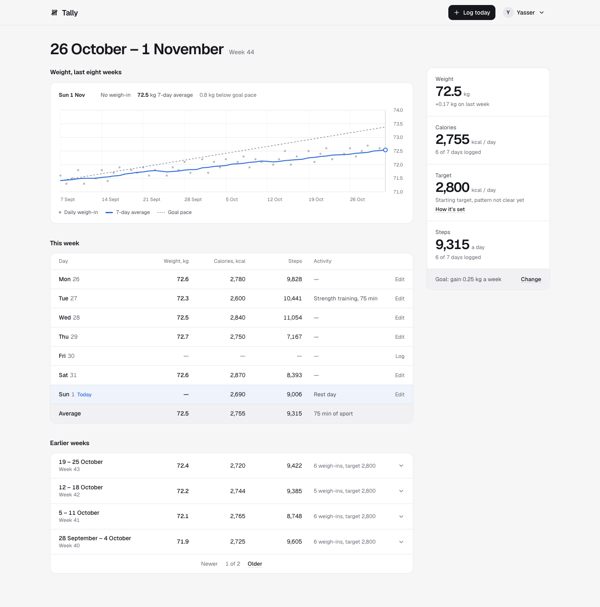

# Tally

[Open Tally](https://tally-web-ten.vercel.app/)

A weekly journal for weight, calories, steps and training. Log each day, follow your weekly averages and your weight trend against your goal, and get a calorie target that adjusts only once your own data supports it.

## Account and dashboard flow

- Signed-out visitors see a short description of Tally next to an example journal, with Create an account and Sign in.
- Forgot password? on the sign-in screen emails a single-use reset link that expires after 30 minutes. Choosing a new password signs the user in and signs out every other session.
- Signup asks for name, email, password, and password confirmation, followed by a required profile setup screen.
- Profile setup collects height, age, weight, optional body fat, and difficulty gaining/losing weight. Incomplete setup resumes after a refresh or later login.
- Users with a saved profile go directly to their journal. New profiles start with maintenance as their goal and a 2,500 kcal starting target, editable in Profile and goals.
- The header has Log today and an account menu with Profile and goals, Sign out, and Clear journal. Clearing requires confirmation and deletes only the signed-in account's entries; the profile and goals are kept.

- The journal page shows the current ISO week: average weight (with the change on last week), calories, steps, and the daily calorie target.
- An eight-week weight chart plots daily weigh-ins, a trailing 7-day average, and the pace implied by the goal, with a hover readout.
- This week lists one row per day with its average; earlier weeks are summarised four at a time and expand to their days. Every past day can be logged or edited.
- Daily check-ins hold weight, calories, and optional steps. Zero steps and missing steps are distinct.
- Optional daily sport type and duration, including explicit rest days.
- Editable profile: height, starting weight, age, optional body fat, difficulty gaining/losing weight, main activity and sessions per week, goal, pace, and starting calorie target.
- The account name appears in the header and profile even before the full profile is saved.
- Session loading and connection errors are handled before displaying account data.
- Experimental calorie calculation implemented in both TypeScript and Python.

The public frontend opens with account access. The previous sample dashboard and interactive-preview banner are no longer displayed. Signed-in journals are saved by the hosted FastAPI service in Neon PostgreSQL.

## Stack

The app uses Next.js App Router source and React. Styling is plain CSS in `app/globals.css` (a neutral palette with one data colour and an automatic dark mode), with Radix-based shadcn/ui primitives for buttons, inputs, dialogs and menus. The weight chart is hand-written SVG. Geist is self-hosted from `public/fonts` under the SIL Open Font License. The Sites build uses Vinext, a Next.js-compatible runtime. Standard Next.js development/build scripts are included for separate hosting. The backend is Python FastAPI, SQLAlchemy, PostgreSQL, Argon2 password hashing, and scikit-learn Ridge regression.

## Local full-stack setup

Requirements: Node 22+, pnpm, and Docker Compose.

1. Copy `.env.example` to `.env`. Replace the example database password with a strong URL-safe random value. Keep `COOKIE_SECURE=false` only for local HTTP development.
2. Run `docker compose up --build -d` to start PostgreSQL and FastAPI.
3. Run `pnpm install --frozen-lockfile`.
4. Run `pnpm next:dev` and open `http://localhost:3000`.
5. Create an account, complete the profile, and log a day. The Next.js API proxy forwards to FastAPI, preserving the secure session cookie when deployed over HTTPS.

The database is in the `tally_data` Docker volume. Initial tables are created on API startup. Future schema changes require proper migrations; `create_all` does not alter existing tables.

Existing databases need `backend/migrations/20261003_add_activity.sql` and `backend/migrations/20261003_add_steps.sql` applied before deploying the corresponding API changes. Fresh databases get these columns on startup. The `password_resets` table (`backend/migrations/20261013_add_password_resets.sql`) is new, so the API also creates it on startup. The same goes for `profile_photos` (`backend/migrations/20261101_add_profile_photos.sql`).

For a Python-only local run, create a Python 3.12 virtual environment, install `backend/requirements.txt`, set `DATABASE_URL` to your PostgreSQL connection URL and `ALLOWED_ORIGINS` to your frontend origin, and run `uvicorn app.main:app` from `backend/`. Install `backend/requirements-dev.txt` when running tests.

## Connect real online accounts

The repository includes deployment configuration for two Vercel projects: the Next.js frontend at the repository root and FastAPI at `backend/`. See [the Vercel deployment guide](docs/deployment.md) for the exact settings and verification steps. Both run independently of the developer's laptop.

1. Deploy FastAPI to Vercel with root directory `backend/`, or deploy `backend/Dockerfile` on a Python/container host.
2. Set `DATABASE_URL` to the PostgreSQL URL with `postgresql+psycopg://` as the scheme. Use the provider's required TLS settings.
3. Set `ALLOWED_ORIGINS` to the exact frontend HTTPS origin and `COOKIE_SECURE=true`.
4. Set the frontend runtime `API_BASE_URL` to the API HTTPS origin, without `/api` at the end. This is server-side configuration, not a browser setting.
5. Check `/health`, then test signup, profile saving, a daily entry, logout, login, and cross-user isolation against the deployed PostgreSQL instance.

The UI checks for a session on startup. A configured API origin is required for account access. Existing local preview logs are not copied into accounts.

## API

- `POST /api/auth/signup`, `POST /api/auth/login`, `POST /api/auth/logout`
- `POST /api/auth/forgot-password` with `{"email":…}`, `POST /api/auth/reset-password` with `{"token":…,"password":…,"confirm_password":…}`
- `GET /api/journal`
- `PUT /api/profile`
- `PUT /api/entries/{YYYY-MM-DD}`
- `DELETE /api/entries` with `{"confirm":true}` clears the current user's journal
- `GET /api/recommendation?before=YYYY-MM-DD`
- `GET /health`

Sessions use random opaque tokens in HttpOnly, SameSite cookies. Only their SHA-256 hashes are stored. All profile and entry queries are scoped to the authenticated user. Mutation requests require JSON and an allowed origin when the browser supplies one. Authentication attempts have a database-backed per-email limit; broader infrastructure rate limiting should be configured with production hosting.

Password reset tokens are random, stored only as SHA-256 hashes, valid for 30 minutes, and invalidated after use or when a newer link is requested. The link carries the token in the URL fragment, which browsers do not send to servers or in Referer headers, and the app removes it from the address bar. The forgot-password response is identical whether or not the email has an account, and reset requests have their own limit of three per email every 15 minutes. Reset emails are sent over SMTP; set `SMTP_HOST`, `SMTP_PORT`, `SMTP_USERNAME`, `SMTP_PASSWORD`, `EMAIL_FROM`, and `APP_URL` on the API (see the deployment guide). Without `SMTP_HOST`, the reset endpoints return 503.

## Experimental model

The first model learns the relationship between each user's weekly average calories and week-to-week average weight changes from the journal. The goal, pace, and starting target in the profile set the desired weight change and bound the resulting target. Other profile measurements and difficulty answers are stored, but are not regression features: one person's constant age/height cannot teach a regression how those attributes affect metabolism.

Users may log steps walked, sport type (strength training, endurance, team sport, another activity, or no sport), and sport duration for each day. Missing entries remain unknown; a logged zero counts as zero steps or an explicit rest day. Weekly steps are the mean of reported days when at least five days have step logs. Sport totals by category require at least five explicit activity reports.

After at least ten eligible weekly samples, the Python model tests a single prespecified richer feature set: calories plus steps and sport when both are sufficiently logged, calories plus steps when only steps qualify, or calories plus sport when only sport qualifies. The activity features must vary enough in training weeks. All candidate features are standardized using training weeks only. The richer model is used only if it improves predictions over calories alone and the constant baseline on the same two later weeks, while passing the calorie-slope and error bounds. Otherwise the calorie-only model remains. An activity-aware estimate assumes the latest logged routine continues. Signed-in accounts receive the hosted Python estimate for the current week; the browser uses the calorie-only calculation for historical weeks and while the hosted estimate loads.

The profile also stores the user's usual activity and weekly session frequency. Those are a routine description; because they are constant for one user, the per-user regression learns from the dated activity and step logs instead.

A usable week needs at least five weigh-ins and five calorie logs. Six eligible consecutive-week pairs are required (at least seven calendar weeks). Up to twelve recent pairs are used. The last two are held out chronologically; the model must beat a mean-change baseline, have sufficient calorie variation, and meet coefficient/error bounds before producing an estimate. Otherwise the user-set baseline remains unchanged. Historical targets never use entries from later weeks.

The estimate is limited to ±100 kcal from the starting target and is not automatically applied to the user's plan. These are product bounds, not medically validated safety limits. This is an experimental planning model without clinical validation, and associations in logged data do not establish causation. Water, illness, incomplete logs, and changes in metabolism can invalidate estimates.

Sources: [scikit-learn Ridge](https://scikit-learn.org/stable/modules/generated/sklearn.linear_model.Ridge.html), [FastAPI authentication](https://fastapi.tiangolo.com/tutorial/security/oauth2-jwt/), [NIDDK weight planning](https://www.niddk.nih.gov/health-information/weight-management/body-weight-planner).

## Verification

Run `cd backend && .venv/bin/python -m pytest -q` after installing `requirements-dev.txt`. The focused test suite checks authentication, password confirmation, password reset (single use, expiry, rate limit, session revocation, no account disclosure), unfinished profile setup, persisted logs including zero and omitted steps, logout/login, confirmation and user isolation for journal reset, invalid input, rate limiting, model fallback, held-out behavior, and historical leakage. API tests use SQLite as a fast test substitute. Production schema and deployments should be checked separately.

`pnpm exec tsc --noEmit` validates the frontend types. `pnpm next:build` checks standard Next.js compatibility. Sites publishing uses the included production Worker build scripts.

Browser WebMCP tools expose journal reads and daily log saves when supported. The current environment has no permitted supported WebMCP/browser QA context, so their browser registration has not been validated.
